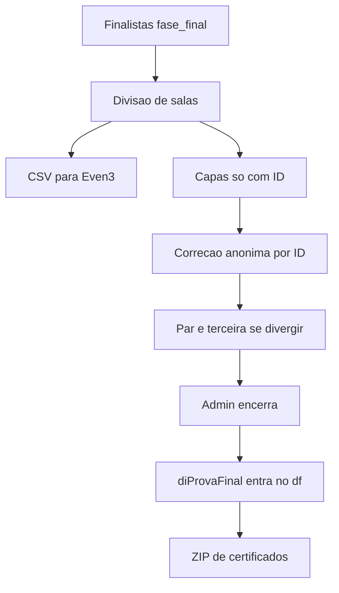

# Spec: Final presencial (Patos)

| Campo | Valor |
|---|---|
| Slug | `064-final-presencial` |
| Status | aprovada |
| Firebase | principal |

A final é 05/12/2026, 08:00–12:00, no IFSertãoPB Campus Patos. Blocos 1, 2 e 4 estão no código. O bloco 3 (tela `/correcao-final`) continua parado: não há planilha de critérios.

Quatro blocos. Recusar um não derruba os outros.

## Problema / valor

A comissão precisa chegar em Patos com as equipes já em salas, identificar a prova sem revelar a equipe ao corretor, corrigir no site com o mesmo mecanismo do portfólio e, ao encerrar, somar a nota no desempenho e emitir os PDFs da premiação.

## Atores

- [x] Estudante — só o efeito: nota no `df` já exibido hoje e certificado. Não vê sala alheia nem fila de correção.
- [x] Professor (`documentoStatus`) — o orientador entra no CSV e no certificado. Não corrige e não vê a fila.
- [x] Admin principal — salas, CSV, capas, banca, encerrar correção, cortes, ZIP dos certificados.
- [ ] Atendente (`SUPPORT_ADMIN_EMAILS`)
- [x] Corretor da final — lista definida pelo admin. Não são os 7 nomes fixos de `src/lib/correcao.js` e não é o auto-cadastro por nome citado em `docs/KNOWN_ISSUES.md` §1.12.

## Decisões

- **Credencial de chegada fica no Even3.** O site só exporta CSV. Não há serviço de e-mail no projeto e o plano Spark não dispara centenas de e-mails nem segura check-in simultâneo numa rede instável. QR e e-mail são o produto do Even3.
- **Correção da prova não mexe na página do portfólio.** Reusa o painel e as funções puras (`decidirVeredito`, escala, rascunho), em rota e coleção novas. A `/correcao` mostra o nome da equipe; misturar os dois fluxos quebra o anonimato e a rubrica `banners-2026-10`.
- **A nota não entra no `df` a cada veredito.** Entra numa ação explícita de encerrar, quando todos os vereditos estiverem fechados. O portfólio grava na hora; aqui isso revelaria o placar no meio da correção.
- **Medalhas: default do edital 6.3** (ouro 1ª–10ª, prata 11ª–25ª, bronze 26ª–50ª, cristal 51ª–120ª). O admin informa outros cortes antes de gerar o PDF, se a comissão mudar os números.
- **Rubrica da prova física não existe.** O mecanismo entra nesta spec; a tela não se implementa sem a planilha de critérios (o mesmo papel de `Avaliação_dos_Banners_DHPB.xlsx` na spec 047).
- **QR na capa da prova fica fora da v1.** O corretor digita o ID da equipe. Câmera exige lib de QR que o projeto não tem. "Escanear por ID" é busca pelo ID impresso em fonte grande.
- **Sala de restrição religiosa (edital 7.20) fica fora.** Não há campo na equipe para isso.

## Viabilidade

- **Even3:** viável fora do código. O site já tem nome, e-mail e papel em `equipes.membros`, mais escola, modalidade e, depois do bloco 2, a sala. Trabalho no DHPB: um botão em `src/app/admin/final/page.jsx` que baixa CSV no navegador, zero leitura nova. Colunas: nome, e-mail, papel, `equipeId`, nome da equipe, escola, modalidade, sala. Coluna `acessoProva`: sim só para estudante. O edital 5.18 veta o professor orientador na sala de prova; a cerimônia pode usar o mesmo CSV com outro tipo de ingresso no Even3.
- **Salas:** viável. Cada finalista já tem `modalidade`, `tipoEscola` e `escolaId`. A página da final já lê `equipes` com `edicaoId` + `aprovadoAte == fase_final`. A divisão roda no navegador. Gravação: um `writeBatch` em cerca de 120 equipes.
- **Correção anônima:** viável no mecanismo, bloqueada na rubrica. O anonimato é de tela (não mostra nome, escola, cidade, membros). Quem também entra no admin continua podendo cruzar o ID. Corretores da final não devem usar a conta de admin.
- **Soma no ranking:** viável com um cuidado. `calcularEquipe` em `src/lib/recalcularPontuacao.js` reconstrói o `df` só a partir das fases online. Um `increment` solto no `df` some no próximo recálculo. A nota da prova tem de entrar nessa função. Antes de gravar, ler o `peso` das 4 fases. O edital 5.19 fecha em 3100 = 100×(1+2+4+8+16) e a prova presencial vale 0–100 (item 5.16). Se a soma dos pesos online for 15, a prova entra com peso 16 (`di = nota × 16`). Se a soma já for 31, parar: o 16 já foi usado e gravar de novo estoura o teto do edital. Esse número está no Firestore, não no repositório.
- **PDFs:** viável com `jspdf` e `jszip`, já instalados (specs 059 e 062). A arte de cada medalha pode ser a de `src/app/certificado-medalha/page.jsx`; se o fundo não distinguir ouro/prata/bronze/cristal, o PDF da cerimônia sai com texto (nome, equipe, colocação, categoria) até a arte chegar. `src/app/admin/medalhas/page.jsx` hoje marca `premiacao` à mão, em ordem alfabética, sem olhar o `df`. A classificação passa a sair da nota, não desse select.

## Bloco 1 — Credencial

Fora do site: importar o CSV no Even3. O Even3 manda o e-mail com o QR e faz o check-in em Patos.

No site: o botão de CSV usa a lista que a aba final já carregou. Sem sala gerada, a coluna sala sai vazia e a tela avisa.

## Bloco 2 — Salas

Na aba final, o admin informa `x` salas de ensino médio e `y` de ensino fundamental, com `x + y` ≤ 12 e pelo menos 1 sala para cada grupo que tenha equipe.

Grupos, com a mesma regra de `colunaDe` em `src/lib/correcao.js`:

- Médio: `medio` e `eja_medio`.
- Fundamental: `fundamental`, `eja_fundamental` e `eja`.

Pública e particular ficam no mesmo grupo. Rede pública continua `municipal`, `estadual`, `federal`, `publica` (`getRede` em `src/lib/eliminacaoFases.js`).

Algoritmo guloso, determinístico, num arquivo puro `src/lib/salasFinal.js` com um assert. Escolas com mais equipes entram primeiro. Para cada equipe, a sala daquele grupo que minimiza, nesta ordem: equipes da mesma `escolaId`, equipes da mesma rede, total na sala. Empate quebra por número da sala.

Não é o ótimo global. Comentário `ponytail:` no código: teto = guloso; upgrade = troca local de pares. Se uma escola tiver mais equipes do que salas do grupo, a colisão é inevitável. A tela lista essas colisões. O admin troca a sala no card; a troca fica marcada como manual. "Refazer divisão" pede confirmação e apaga o manual.

Grava em `equipes/{id}.salaFinal`: `{ numero, grupo, manual }`. Não mexe em `aprovadoAte`.

Na lista de finalistas, "Agrupar por sala" reúne os cards por número de sala (sem sala no fim), para o encaminhamento presencial. "Lista alfabética" volta a ordem de nome.

Capas para a prova: PDF no navegador, uma página por equipe, só com o ID em fonte grande e o número da sala para a comissão destacar e separar. Sem nome e sem escola. Quem imprime e quem corrige não precisam ser a mesma pessoa; a capa que o corretor recebe não leva o nome.

## Bloco 3 — Correção

Rota nova `/correcao-final`. Coleção nova `correcoes/final/correcoes/{equipeId}` e `correcoes/final/vereditos/{equipeId}`, rubrica própria (`prova-final-2026`), para não ler nem apagar `correcoes/fase4`.

O admin, na aba final, monta a banca: nome, e-mail, campus, salas. Cada sala tem exatamente 2 corretores. A mesma pessoa pode pegar várias salas. A fila de cada um é o conjunto de IDs daquelas salas.

Tela do corretor, igual ao painel do portfólio: critérios à direita, níveis Concordo Totalmente `1` · Parcialmente `0,75` · Neutro `0,50` · Discordo Parcialmente `0,25` · Discordo Totalmente `0`. Critério vazio bloqueia o envio. Rascunho no `localStorage` até "Enviar". O cabeçalho mostra só o ID digitado. A busca não completa com nome.

Divergência, como hoje: 2 notas; se a diferença for ≥ 20, um 3º corretor (fora os dois, fora o campus da equipe quando houver outro). Com 3 notas, descarta a menor e tira a média das 2 maiores. Veredito fecha sozinho. Sem 3º disponível, fica aberto e o admin vê. Texto de divergência usa o ID, nunca o nome.

A nota fechada fica no veredito. Não grava `df` ainda.

Leituras no mesmo padrão da `/correcao`: documento único da distribuição, `getDoc` por equipe da fila, query das correções com `where` + `limit`. Sem `getDocs(collection)` solto. O doc da correção não precisa copiar nome nem escola.

## Bloco 4 — Encerrar, ranking, certificados

Botão "Encerrar correção" só habilita com todo veredito `fechado`. Preview mostra nota 0–100, `di` e `df` antigo/novo. Confirmar grava, por transação e de forma idempotente:

- `notaProvaFinal` (0–100) e `diProvaFinal` (`nota × peso`)
- `df` incluindo esse `di`
- `calcularEquipe` passa a somar `diProvaFinal`, senão o recálculo do admin apaga a final

Equipe de teste `LhT2fV3JvyQhZU8PrSFl` fica de fora. Equipe sem veredito não ganha zero automático.

Classificação: `df` depois da prova. Desempate do edital 6.4: maior N3, depois N2, depois N1. Conferir na implementação se `src/lib/eliminacaoFases.js` serve ou se a final precisa da variante "empate nas fases 4 e 5".

Cortes editáveis, default 10 / 25 / 50 / última colocação. O admin baixa um ZIP: um PDF por membro ativo (estudante e professor), com categoria ouro, prata, bronze ou cristal. Grava `premiacao` na equipe para a página de medalha que já existe continuar coerente. Não publica ranking novo. O `df` aparece só onde o site já o mostra.

## Escopo negativo

Não altera `questao`, `criar-equipe`, `montagem-equipe`, `AuthContext`, `firebase.js`, `firestore-rest.js`, `escolas-pb.json`, `membro-index`, chat, rubrica do portfólio, distribuição da fase 4, nem o fluxo de presença/camisa (specs 050–056). Não envia e-mail. Não cria fase online nova no menu do aluno (uma fase `aberta` abriria prova no site). Não edita o regulamento.

## As-is vs to-be

| Regra | No código hoje | Depois desta spec |
|---|---|---|
| Credencial | Sem CSV e sem e-mail | Aba final baixa CSV; QR e check-in ficam no Even3 |
| Salas | Lista finalistas, sem sala | Admin define `x` e `y`; guloso grava `salaFinal`; troca manual sobrevive ao reload |
| Capa da prova | Não existe | PDF só com ID e número da sala |
| Correção | `/correcao` do portfólio, com nome da equipe | `/correcao-final`, só o ID, rubrica `prova-final-2026`, coleção separada |
| Banca | 7 corretores fixos, distribuição por campus e carga | Admin monta a banca; 2 corretores por sala; 3ª correção segue a regra atual |
| Nota no `df` | Portfólio grava ao fechar o veredito; `calcularEquipe` ignora prova presencial | Encerrar grava `notaProvaFinal` e `diProvaFinal`; veredito aberto não grava; segunda vez não soma de novo |
| Medalhas | `premiacao` manual, ordem alfabética | Cortes do edital 6.3, editáveis; ZIP com um PDF por membro ativo |

## Firestore

**Leituras:** as que `/admin/final` e a correção já fazem, sempre com `where` e, na correção, `limit`. Escolas só em `public/escolas-pb.json`. Uma leitura das 4 fases, só no encerrar, para checar a soma dos pesos. Path de aluno/prova: zero full scan.

**Writes:** `writeBatch` em `salaFinal`; transação por envio de correção (igual `mesclarCorrecao`, `set` sem merge); no encerrar, transação idempotente com `notaProvaFinal`, `diProvaFinal` e `df` que já inclui esse `di`. `aprovadoAte` e `membro-index`: nenhum.

## Required reading

1. `docs/PROJECT_CONTEXT.md`
2. `docs/CONSTITUTION.md`
3. `docs/BUSINESS_RULES.md` §1.4
4. `src/lib/correcao.js` e `src/lib/criterios.js`
5. `src/app/admin/final/page.jsx`
6. `src/lib/recalcularPontuacao.js`

## Critérios de aceite

- [x] CSV da aba final abre no Even3 com um participante por linha e a sala preenchida depois da divisão
- [x] Médio e fundamental não compartilham sala; pública e particular compartilham; a tela mostra quando a mesma escola cai junta
- [x] Troca manual de sala sobrevive a um reload e só some se o admin refizer a divisão
- [ ] Corretor vê o ID e os critérios, e não vê nome, escola nem cidade. A `/correcao` do portfólio segue igual
- [ ] Divergência ≥ 20 pede 3ª correção; abaixo disso fecha na média das duas
- [x] Encerrar com veredito aberto não grava. Encerrar duas vezes não soma de novo
- [x] `calcularEquipe` não apaga `diProvaFinal`
- [x] Se a soma dos pesos das fases online não for 15, o encerrar não grava e explica o número encontrado
- [x] ZIP traz um PDF por membro ativo na categoria do edital, ou na faixa que o admin digitou
- [ ] Cota Spark: nenhuma query nova sem filtro no path do participante
- [ ] `npm run build` código 0
- [ ] `docs/BUSINESS_RULES.md` e `docs/DATABASE.md` atualizados no mesmo passo da implementação

## Fora até a comissão mandar

- Planilha dos critérios da prova (bloqueia o bloco 3).
- Confirmação dos pesos reais das 4 fases no Firestore. Na edição 4º DHPB, em 20/11/2026, preparar o encerramento passou dessa checagem: a tela acusou veredito ausente, não soma diferente de 15. O peso 16 segue condicionado a essa checagem na hora de gravar.
- Arte dos quatro certificados, se o fundo atual não servir.
- Qualquer check-in dentro do DHPB, se o Even3 for recusado.

## Princípios da constitution aplicáveis

- Free Tier: CSV, divisão e PDF rodam no navegador sobre dados já lidos. Correção segue o padrão da `/correcao` (`where` + `limit`, sem full scan, sem `collectionGroup`).
- Escolas só em `public/escolas-pb.json`.
- Atomicidade: envio da correção e encerramento usam transação. Encerrar é idempotente. `calcularEquipe` passa a preservar `diProvaFinal` para o recálculo não apagar a final.
- Isolamento: `correcoes/final` não mistura com `correcoes/fase4`. Banco de suporte intocado.
- Sem dependência nova, sem e-mail, sem segredo em cliente.
- Não cria fase com status `aberta`. Uma fase aberta liberaria prova online.
- Página nova interativa leva `'use client'`. `useSearchParams` exige `<Suspense>`.
